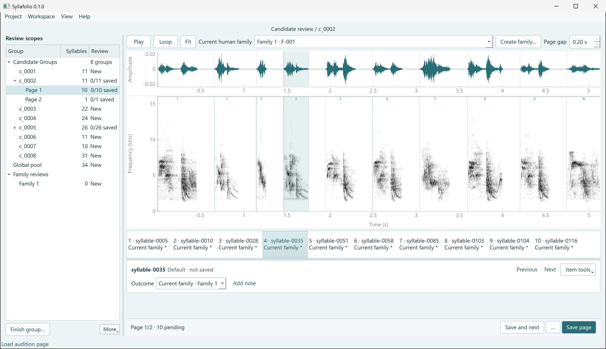

# Syllafolio

Syllafolio is a Windows desktop application for listening to syllables, comparing spectrograms, annotating human-defined families and exporting a catalogue. Its interface, installer, system messages and new catalogue reports use English. Project names, family names, filenames and operator notes retain their original language.

[](docs/images/syllable-review.png)

These ten syllables come from recordings of Eurasian tree sparrows (*Passer montanus*). The reviewer can play the whole row to compare calls, or loop the selected syllable while deciding which family it belongs to.

## Install on Windows x64

Open the [Syllafolio v1.0.1 Windows release](https://github.com/linlin0329/Syllafolio/releases/tag/v1.0.1). Download **Syllafolio-Setup-1.0.1-x64.exe** and compare its SHA-256 with the entry in **SHA256SUMS.txt**.

```powershell
Get-FileHash -Algorithm SHA256 .\Syllafolio-Setup-1.0.1-x64.exe
```

Double-click the installer and choose **Install**. Open **Syllafolio** from the desktop shortcut or the Start menu. If you prefer to keep the desktop clear, uncheck **Create a desktop shortcut** before installing. The installation is for the current Windows account. You can also download **Syllafolio-Windows-x64.zip**, extract the whole folder and double-click `Start.cmd`.

## Try Syllafolio with example audio

To try Syllafolio with real bird recordings, download
`Syllafolio-example-audio-180-syllables-v1.0.0.zip` from
[Zenodo](https://doi.org/10.5281/zenodo.24213511). It contains 180 Eurasian
tree sparrow syllables and the 26 recording excerpts they came from.
The syllables open without preassigned type labels, so you can listen,
compare spectrograms and make your own annotations.

Extract the ZIP. In Syllafolio, choose **Project → New project from syllables…**
and select the `data/` folder containing `segments.json`. The README inside
the archive explains how to import the audio and play your first group of
syllables.

## Review a project

1. Choose **Project → New project from syllables…** for a folder of segmented audio, or **Project → New project from recording and annotations…** for one recording and a TextGrid, Audacity or single-recording Raven table. Preview and audition the intervals before confirming the project details. External labels remain source references, not automatic family assignments. To inspect existing work, choose **Open project…** and select a properly closed project copy.
2. Select a scope in **Candidate Groups**, **Global pool** or **Family reviews**, then click **Prepare group**.
3. Use **Play** to hear the page once or **Loop** to repeat it. Click a syllable to listen to it alone, or Ctrl-click several syllables to compare them. **Fit** restores the full page and frequency range.
4. Select a human family and edit any exceptions. **Save and next** saves the current item and advances. **Save page** submits all eligible pending items on that page.
5. Choose **Project → Export saved records…** for JSON, or **Workspace → Catalogue delivery** for a catalogue with a manifest and an offline report.

To compare ways to group the imported syllables, right-click **Candidate Groups** and choose **Compare groupings…**. The finer, default and coarser options show the number of groups, the size of the largest group and the share of syllables left in the global pool. Select a group to listen to a sample. Applying an option updates the project's review groups.

See the [user guide](tools/distribution/USER_GUIDE.md) for type definitions, checkpoints, source declarations and internal assessment.

Both input routes accept mono or stereo WAV, FLAC, MP3, Ogg Vorbis and AIFF (`.aif`/`.aiff`) at 32,000 Hz or higher. For stereo files, Syllafolio averages the left and right channels before optional filtering, playback and feature extraction. It keeps the original sample rate and interval boundaries. Mono and stereo files can share a batch if their sample rates match. Each syllable can be up to 30 seconds long.

Both new-project routes offer an optional **Band-pass filter**, off by default. Its adjustable defaults are **500–15000 Hz**, Butterworth order **4**. When enabled, the complete source is filtered before intervals are cut; project audition and features use that filtered PCM. Original input files remain unchanged. See the user guide before choosing preprocessing settings.

## Run the source checkout

Use Windows x64 with CPython 3.12.10. Run these commands from the repository root:

The application package is `src/syllafolio`; its bundled acoustic kernels are in `src/syllafolio/acoustics`. `run.py` starts this package directly. No separate workflow checkout is required.

```powershell
py -3.12 -m venv .venv
.\.venv\Scripts\python.exe -m pip install --only-binary=:all: --require-hashes -r requirements.txt
.\.venv\Scripts\python.exe -X utf8 run.py
.\.venv\Scripts\python.exe -X utf8 -m unittest discover -s tests
```

The tests generate a signal in memory to exercise acoustic feature extraction. See [BUILDING.md](BUILDING.md) to rebuild the Windows distribution.

## License

Syllafolio's original application code is licensed under the [MIT License](LICENSE). Copyright (c) 2026 Zhaocun Lin.

Third-party components retain their respective licenses. The [Zenodo example audio and its metadata](https://doi.org/10.5281/zenodo.24213511) are available under [CC BY 4.0](https://creativecommons.org/licenses/by/4.0/).
